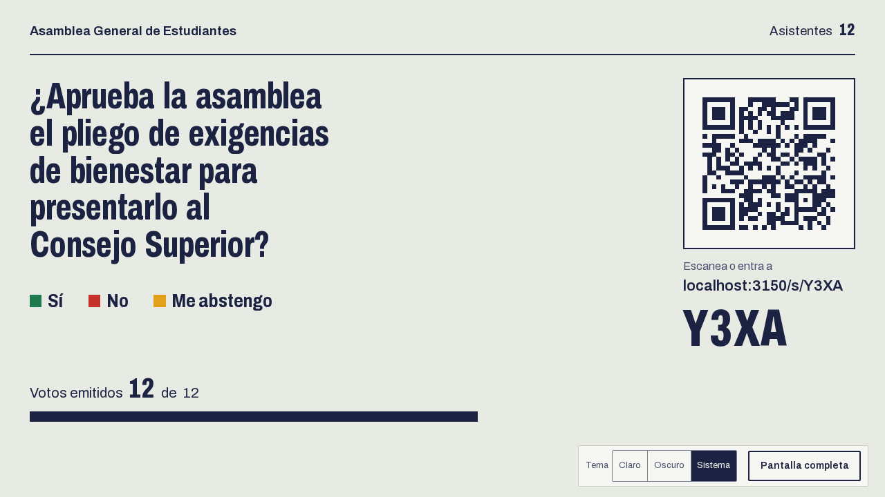
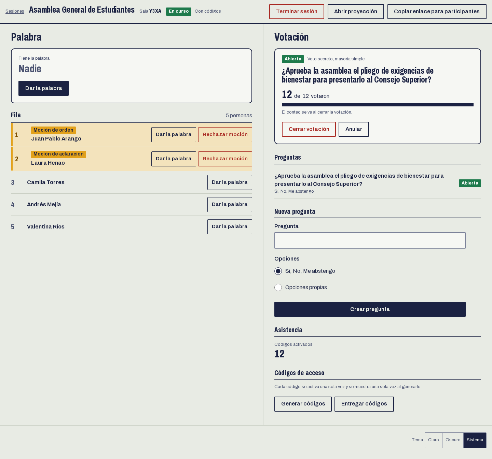
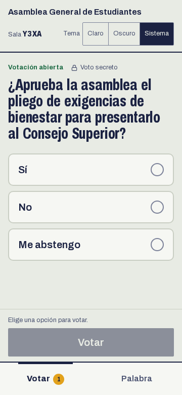
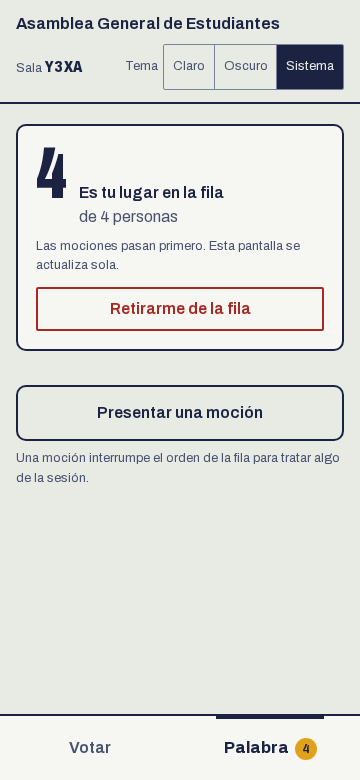
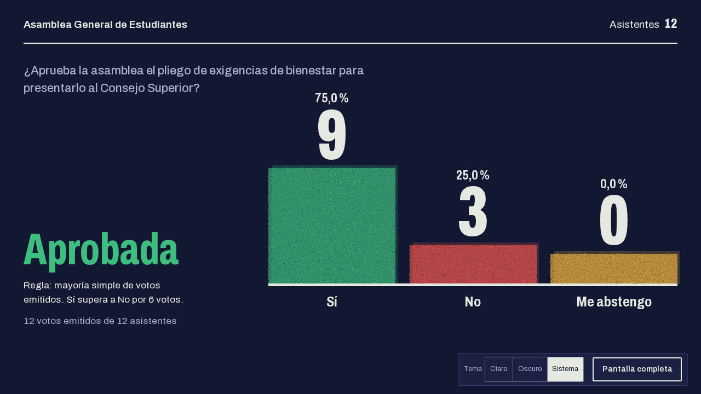

# Kuorum Estudiantil

Herramienta de código abierto para conducir asambleas estudiantiles: proyecta la pregunta y el QR para votar, recibe los votos desde el celular, lleva la fila de quienes piden la palabra y las mociones, y deja todo listo para el acta. Cualquier asamblea la puede desplegar en su propia cuenta de Vercel, en el plan gratuito.

Nació para la Asamblea de Estudiantes de la Universidad de Antioquia, pero no depende de ninguna institución: el nombre, los dominios de correo y las facultades se configuran al instalarla.

> **Estado:** la sala en vivo (fase 1a) está completa en la rama `fase-1a`: portada, mesa, proyección y celular, con pruebas de punta a punta. Todavía no se ha usado en una asamblea real, así que pruébala antes con una sesión de ensayo.

## Capturas

| Proyección con una votación abierta                                 | Mesa                                                  |
| ------------------------------------------------------------------- | ----------------------------------------------------- |
|  |  |

| Celular, votar                                          | Celular, en la fila                                      | Resultado, modo oscuro                                                 |
| ------------------------------------------------------- | -------------------------------------------------------- | ---------------------------------------------------------------------- |
|  |  |  |

Guías paso a paso: [la mesa](docs/uso/mesa.md), [el participante](docs/uso/participante.md) y [la proyección](docs/uso/proyeccion.md).

## Qué hace

Cada sesión de la asamblea es una **sala** con un código corto (por ejemplo `K7F2`). La sala tiene tres vistas:

| Vista      | Para quién                                    | Qué muestra                                                                                                       |
| ---------- | --------------------------------------------- | ----------------------------------------------------------------------------------------------------------------- |
| Proyección | El videobeam o la pantalla compartida en Zoom | La pregunta con su QR, el avance de los votos, los resultados, quién tiene la palabra con su cronómetro y la fila |
| Celular    | Cada estudiante                               | Votar, pedir la palabra, presentar una moción y ver su lugar en la fila                                           |
| Mesa       | Quien modera                                  | Crear la sala, repartir códigos, abrir y cerrar votaciones, dar la palabra y resolver mociones                    |

### Votación secreta

- Toda pregunta es secreta por defecto.
- La base de datos guarda por un lado quién ya votó y por otro cuántos votos tiene cada opción, sin ninguna fila que una a la persona con su opción. El detalle, incluidos los riesgos que quedan, está en [docs/arquitectura.md](docs/arquitectura.md).
- Un voto emitido no se cambia.

### Un voto por persona sin pedir datos personales

La mesa elige cómo se participa en cada sala:

- **Con códigos (recomendado para decisiones).** La mesa reparte códigos anónimos de un solo uso, impresos o desde su celular, después de revisar el carné. El voto queda atado al código y no al navegador: aunque alguien abra el código en tres navegadores, cuenta un solo voto. El sistema guarda solo un hash del código y nunca sabe a quién se le entregó.
- **Sala abierta.** Se entra solo con el QR. Hay un voto por navegador, y por eso esas votaciones salen marcadas como "Votación indicativa".

La asistencia es anónima y opcional: es el número de códigos activados, sin nombres. No se usan huellas del dispositivo ni direcciones IP para limitar votos.

### Fila de intervenciones y mociones

- Quien pide la palabra entra al final de la fila y escribe cómo quiere que lo anuncien.
- Las mociones pasan adelante según su prioridad: de orden, de procedimiento, de aclaración y de suficiente ilustración.
- La mesa da la palabra en orden o fuera de turno, suma un minuto o rechaza una moción. El cronómetro se sincroniza con la hora del servidor.

### Diseño

- Modo claro, oscuro o el del sistema, con un selector que cada persona guarda.
- Pensado primero para celular y escalado hasta un videobeam en 1920 px.
- Contraste AA, foco de teclado visible y botones de al menos 44 px.

### Pendiente para las próximas versiones

- Facultades, roles por facultad y la vista de la asamblea general sobre las decisiones de cada una.
- Calendario de sesiones con aviso de cruces y exportación a `.ics`.
- Actas en PDF y registro de decisiones.
- Panel para personalizar colores, logo y textos.
- Verificación por correo institucional (Microsoft Entra ID o Google), apagada por defecto.

La arquitectura está en [docs/arquitectura.md](docs/arquitectura.md) y la decisión sobre el tiempo real en [docs/adr/0001-transporte-de-tiempo-real.md](docs/adr/0001-transporte-de-tiempo-real.md).

## Desplegar tu propia instalación

Necesitas una cuenta de GitHub, una de Vercel y Node 22 o superior.

```sh
git clone https://github.com/<tu-usuario>/kuorum-estudiantil.git
cd kuorum-estudiantil
pnpm install
pnpm desplegar
```

El asistente pide el nombre de la institución y deja todo listo:

- crea el proyecto en Vercel y la base de datos Postgres en Neon;
- genera los secretos y carga las variables de entorno;
- despliega, verifica que el sitio responda y crea la cuenta de administración de la mesa.

Si algo falla, vuelve a correrlo y sigue donde quedó. Para publicar una versión nueva usa `pnpm publicar`.

En el plan gratuito de Vercel caben asambleas de facultad de cientos de personas. Para una asamblea general de miles conviene un dominio propio con Cloudflare delante. Las cifras y los pasos están en [docs/despliegue.md](docs/despliegue.md).

## Cómo está hecho

TypeScript en un monorepo con pnpm y Turborepo:

| Paquete                   | Qué contiene                                                                                    |
| ------------------------- | ----------------------------------------------------------------------------------------------- |
| `packages/domain`         | Las reglas de la asamblea (sesión, votación, fila de intervenciones), sin dependencias externas |
| `packages/application`    | Un caso de uso por clase, con sus dependencias inyectadas                                       |
| `packages/infrastructure` | Postgres con Prisma 7 y Neon, hash de códigos, transacciones                                    |
| `packages/contracts`      | Esquemas zod de la API                                                                          |
| `packages/ui`             | Sistema visual y componentes de presentación                                                    |
| `packages/cli`            | El asistente de despliegue                                                                      |
| `apps/web`                | Next.js 16: la API y las tres vistas                                                            |

CI comprueba en cada cambio que las capas no se mezclen: el dominio no puede importar Prisma ni Next, y la aplicación solo importa el dominio.

## Desarrollo local

```sh
pnpm install
podman compose up -d   # o docker compose up -d: Postgres en el puerto 54329
pnpm test              # pruebas unitarias
pnpm test:int          # pruebas contra Postgres
pnpm e2e               # Playwright; instala el navegador con: pnpm --filter @kuorum/web exec playwright install chromium
pnpm lint && pnpm typecheck && pnpm depcheck && pnpm build
```

Para contribuir, lee [CONTRIBUTING.md](CONTRIBUTING.md). Las tareas abiertas están en las [issues](https://github.com/alexizher/kuorum-estudiantil/issues), y las marcadas _good first issue_ sirven para empezar.

## Licencia

[MIT](LICENSE)
