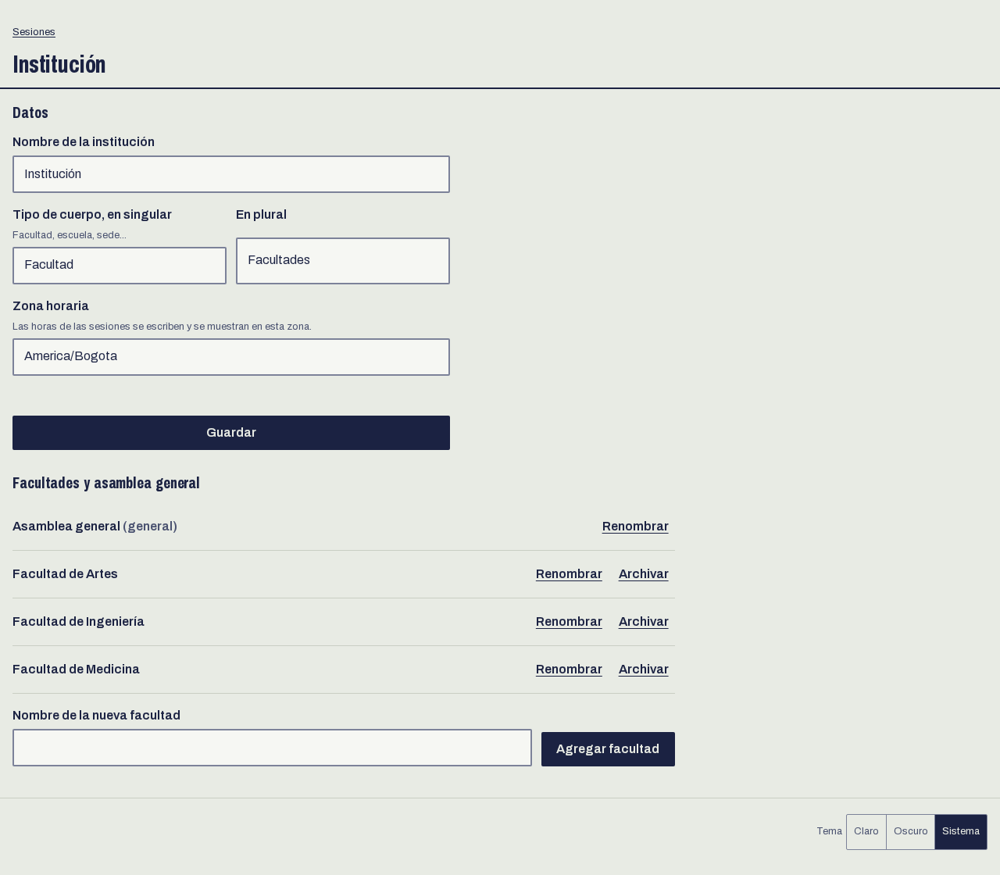
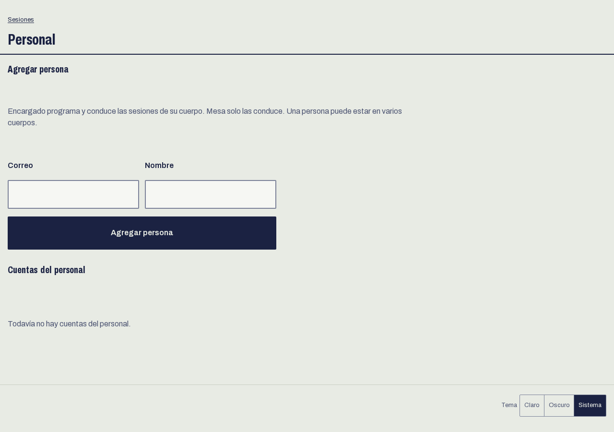
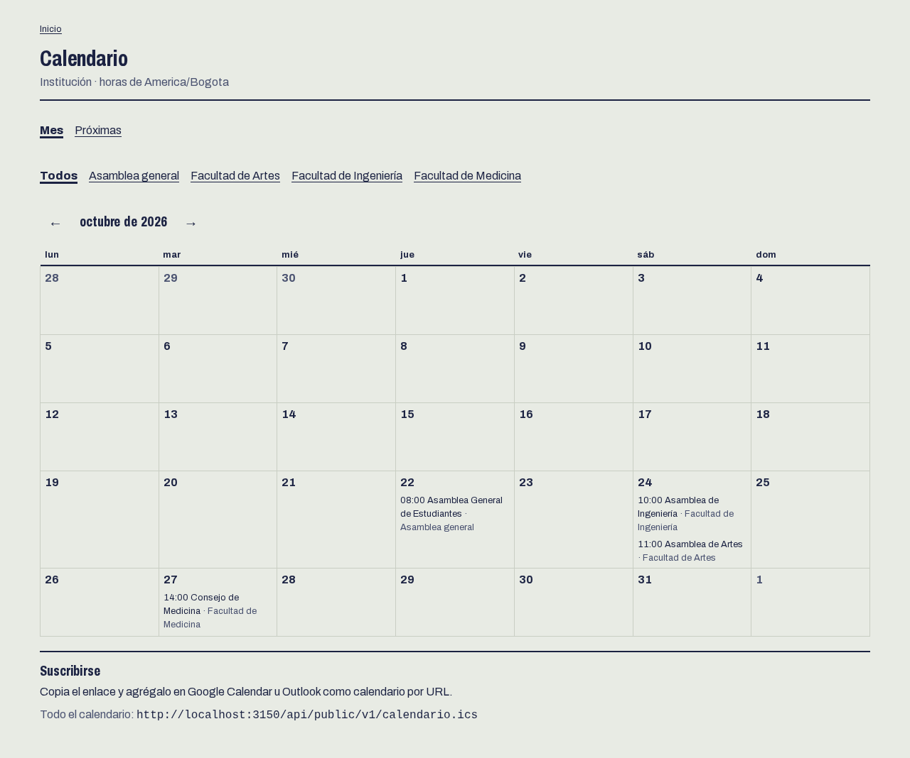
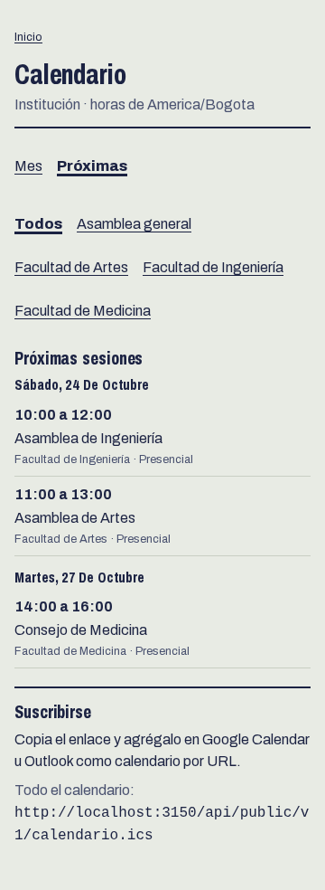

# Guía del administrador

Para quien instaló el sitio. La cuenta de administración (rol `SUPERADMIN`) se crea con `pnpm --filter @kuorum/web crear-admin` o con el asistente de despliegue. Desde la cabecera de `/mesa` tiene dos pantallas más: **Institución** y **Personal**.

## 1. Institución

En `/mesa/institucion` se ponen el nombre de la institución, cómo se llaman sus cuerpos (facultad, escuela, sede, en singular y en plural) y la zona horaria. Las horas de las sesiones se escriben y se muestran en esa zona, así que conviene fijarla antes de programar nada. Viene en `America/Bogota`.

Debajo están los cuerpos. La asamblea general la crea la instalación y no se puede archivar. Cada facultad se agrega con su nombre; el sistema le asigna un identificador corto para las direcciones (`facultad-de-artes`). Dos cuerpos no pueden tener el mismo nombre.

Archivar una facultad impide programar sesiones nuevas en ella. Las que ya tenía se conservan y siguen en el calendario.

## 2. Personal

En `/mesa/personal` se agregan las cuentas de quienes llevan las asambleas. Basta con el correo y el nombre. El sistema genera una contraseña y la muestra una sola vez: entrégasela a la persona por un canal privado. Después ella la cambia en **Mi cuenta**.

Cada persona puede estar en varios cuerpos, con un rol en cada uno:

| Rol en el cuerpo | Qué puede hacer                                                                                         |
| ---------------- | ------------------------------------------------------------------------------------------------------- |
| Encargado        | Programar, reprogramar y cancelar las sesiones del cuerpo, y conducirlas.                               |
| Mesa             | Conducir las sesiones del cuerpo: iniciar, dar la palabra, abrir y cerrar votaciones, repartir códigos. |

Una cuenta sin cuerpos no ve ninguna sesión. Quitarle todos los cuerpos es la forma de retirarle el acceso. Si alguien olvida su contraseña, **Generar contraseña nueva** crea otra, la muestra una vez y cierra las sesiones abiertas de esa cuenta.

El administrador ve y conduce todas las sesiones, salvo que se diga otra cosa más abajo. La cuenta de prueba pública (`DEMO`) no se administra desde aquí.

## 3. Calendario

El calendario es público, en `/calendario`, con vista de mes y de próximas sesiones, filtrable por cuerpo. Lo que programa la cuenta de prueba no aparece. Al pie están los enlaces `.ics` para suscribirse desde Google Calendar u Outlook. Los detalles para integrarlo en otra página están en [la API](../api.md).

| Mes                                                        | Celular                                                        |
| ---------------------------------------------------------- | -------------------------------------------------------------- |
|  |  |
