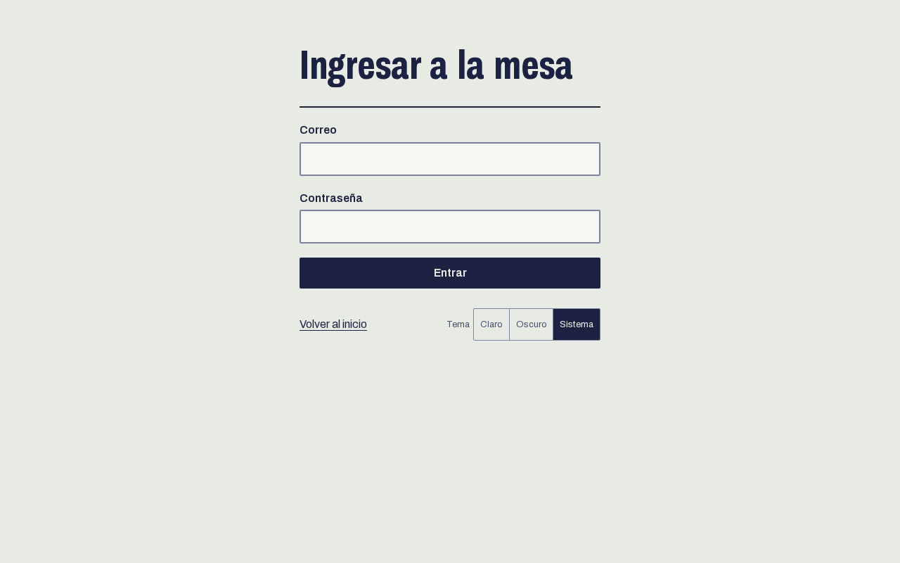
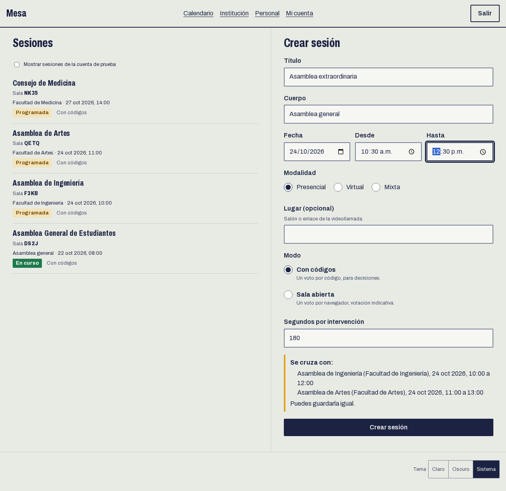
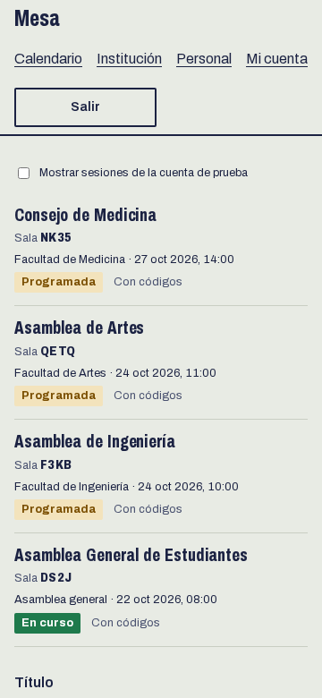
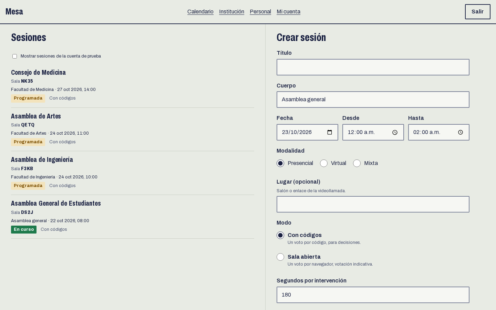
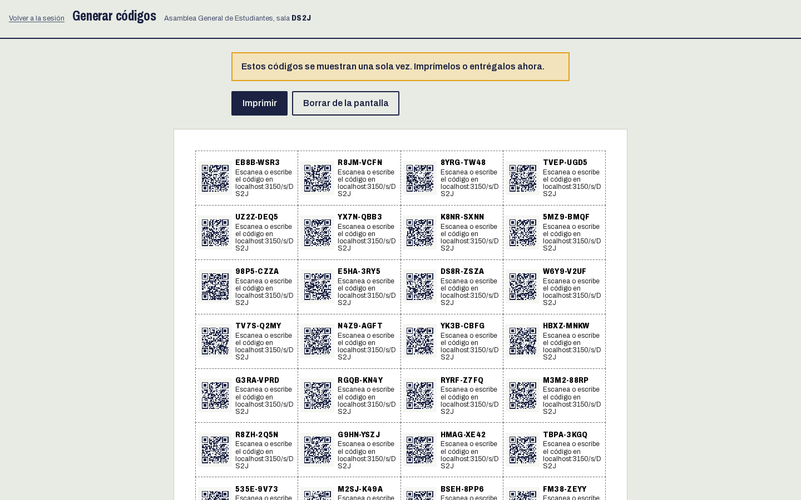
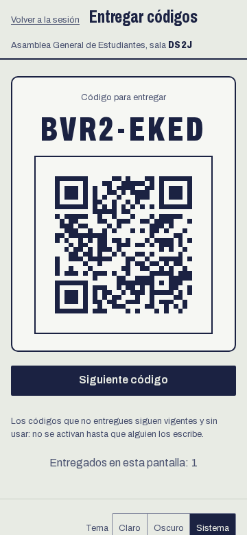
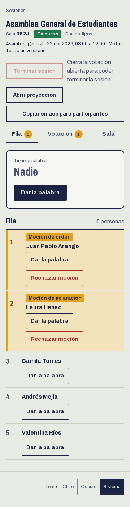
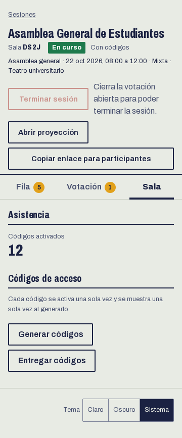
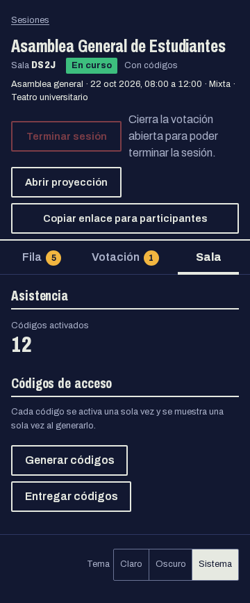

# Guía de la mesa

Para quien modera la asamblea: crea la sala, reparte los códigos, abre y cierra las votaciones y da la palabra. Funciona desde el celular y desde un computador.

## 1. Entrar

La cuenta de la mesa la crea quien instaló el sitio con `pnpm --filter @kuorum/web crear-admin`. Entra en `/mesa/ingresar` con el correo y la contraseña. Después de cinco intentos fallidos en un minuto el ingreso se bloquea un rato.

Cada cuenta tiene un rol. `SUPERADMIN` (quien instaló el sitio) ve y opera todas las sesiones. Las cuentas del personal (`MESA`) las crea el administrador en **Personal** y ven solo las sesiones de los cuerpos donde las agregó: como encargadas programan y conducen, como mesa solo conducen (ver la [guía del administrador](administrador.md)). Una cuenta del personal cambia su contraseña en **Mi cuenta**. `DEMO` es la cuenta de prueba pública: solo ve las sesiones que ella creó, no tiene acceso a las de las demás cuentas, puede tener hasta 5 sesiones sin terminar, genera hasta 50 códigos por vez y 200 por sesión, y no puede cambiar su contraseña. Si el sitio la ofrece, el ingreso muestra su correo y su contraseña en un bloque aparte, con un botón que llena el formulario, y la cabecera de la mesa lleva la insignia "Cuenta de prueba". Sus sesiones se borran cada día.

## 2. Programar la sesión

En `/mesa` escribe el título y elige el cuerpo (si solo puedes programar en uno, aparece fijo), la fecha, la hora de inicio y la de fin, la modalidad (presencial, virtual o mixta) y, si quieres, el lugar o el enlace de la videollamada. Las horas son las de la institución. Si la hora de fin es igual o anterior a la de inicio, la sesión termina al día siguiente, y el formulario lo dice.

Mientras escribes las horas, el formulario busca otras sesiones de la institución en el mismo horario, de cualquier cuerpo, y las muestra bajo **Se cruza con**. Es un aviso: puedes guardarla igual.

Luego elige el modo y los segundos que dura cada intervención.

- **Con códigos.** Cada participante entra con un código anónimo de un solo uso. Es el modo para decisiones.
- **Sala abierta.** Se entra solo con el QR, con un voto por navegador. Las votaciones salen marcadas como "Votación indicativa".

Al crearla recibe un código de sala de cuatro caracteres (en las capturas, `Y3XA`).

| Celular                                                   | Escritorio                                                  |
| --------------------------------------------------------- | ----------------------------------------------------------- |
|  |  |

Mientras la sesión no empiece, quien la programó (o cualquier encargado de su cuerpo) puede **Reprogramar** el título, la fecha, las horas, la modalidad y el lugar, o **Cancelar sesión**. Una sesión cancelada sale tachada en el calendario.

## 3. Repartir los códigos (modo con códigos)

Desde la sesión entra a **Generar códigos**, escribe cuántos necesitas y pulsa **Generar**. Los códigos se muestran una sola vez: el sistema guarda solo su hash y no los puede volver a mostrar. Imprime la lista (40 por hoja carta, cada código con su QR) o guárdala antes de salir de la pantalla.

Para entregarlos uno a uno desde tu celular, usa **Entregar códigos**: muestra un código con su QR, la persona lo escanea y pasas al siguiente. Los que no entregues siguen vigentes y sin usar.

Reparte los códigos después de revisar el carné. El sistema no sabe a quién se le dio cada uno, y de eso depende que el voto sea secreto.

## 4. Iniciar y abrir la proyección

Pulsa **Iniciar sesión**. **Abrir proyección** abre en otra pestaña la pantalla para el videobeam o para compartir en Zoom (ver la [guía de proyección](proyeccion.md)). **Copiar enlace para participantes** deja en el portapapeles la dirección de la sala.

## 5. Votar

En el panel de la sesión escribe la pregunta, elige las opciones (Sí, No y Me abstengo, u opciones propias) y pulsa **Crear pregunta**. Después, **Abrir la votación**.

Mientras está abierta ves cuántas personas votaron y, con códigos, de cuántos activados. El conteo por opción no se ve hasta cerrar.

| Escritorio                                                | Celular                                                 |
| --------------------------------------------------------- | ------------------------------------------------------- |
|  |  |

En el celular el panel se divide en pestañas: Fila, Votación y Sala.

Al **Cerrar votación** ves el resultado, pero la proyección no lo muestra hasta que pulses **Proyectar resultado**. Así puedes revisarlo antes. **Anular** descarta la pregunta sin resultado. Un voto emitido no se cambia.

## 6. Dar la palabra

La fila de intervenciones queda a la izquierda en escritorio y en la pestaña Fila en el celular. Las mociones aparecen arriba, marcadas, en este orden: de orden, de procedimiento, de aclaración y de suficiente ilustración.

- **Dar la palabra** a quien elijas, en el orden de la fila o fuera de turno.
- **Rechazar moción** si no procede.
- **Sumar un minuto** a quien está hablando, o **Terminar** su intervención.

El cronómetro usa la hora del servidor, así que se ve igual en la mesa, la proyección y el celular de quien habla.

## 7. Terminar la sesión

**Terminar sesión** pide confirmación. Después ya no se abren votaciones ni se entregan códigos.

## Tema claro, oscuro y del sistema

El selector está al pie de cada pantalla y cada persona lo guarda en su navegador.

| Claro                                            | Oscuro                                             |
| ------------------------------------------------ | -------------------------------------------------- |
|  |  |
