# Guía del participante

Para quien vota desde su celular. No hay que instalar nada ni crear cuenta.

## 1. Entrar a la sala

Escanea el QR de la proyección o de tu hoja de códigos. También puedes abrir la dirección corta que aparece en pantalla (por ejemplo `localhost:3150/s/Y3XA`, con el dominio de tu asamblea).

En una sala con códigos escribe el código que te entregó la mesa y pulsa **Entrar a la sala**. Si el QR de tu hoja ya lleva el código, entras directo. Si te equivocas, aparece un aviso y puedes intentar otra vez.

| Claro                                                   | Oscuro                                                    |
| ------------------------------------------------------- | --------------------------------------------------------- |
| 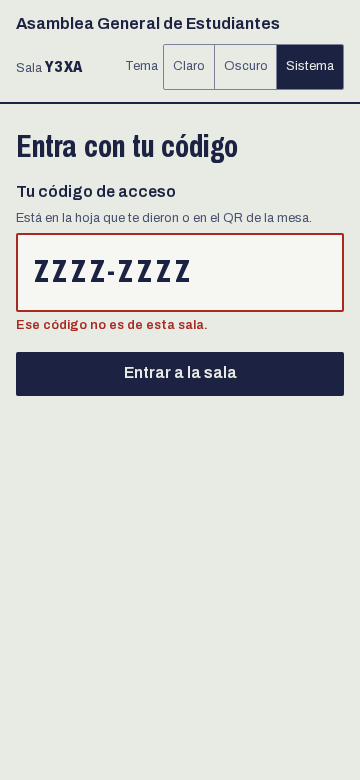 | 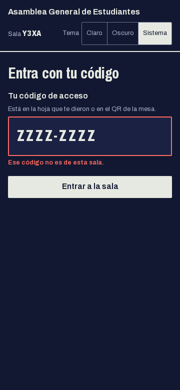 |

Tu código es de un solo uso y es lo que cuenta como tu voto, no el navegador. Si lo abres en dos aparatos, sigue siendo un solo voto. En una sala abierta no pides código y hay un voto por navegador; esas votaciones se marcan como indicativas.

Mientras no haya votación ves esta pantalla, que se actualiza sola:

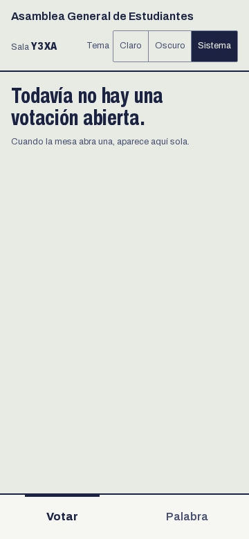

## 2. Votar

Cuando la mesa abre una votación, la pestaña **Votar** muestra la pregunta y las opciones. Elige una y pulsa **Votar**.

| Pregunta abierta                               | Opción elegida                                                   |
| ---------------------------------------------- | ---------------------------------------------------------------- |
|  | 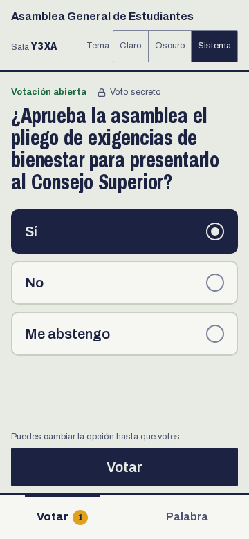 |

El voto es secreto y no se cambia. Al enviarlo ves la confirmación:

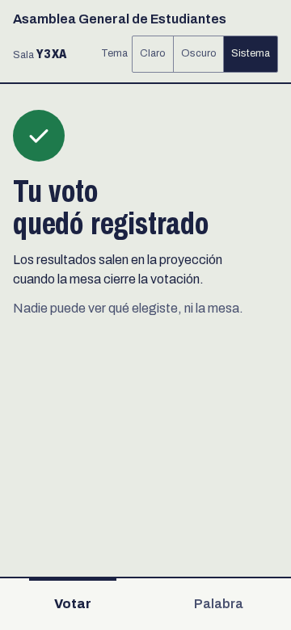

En una tableta o en horizontal la misma pantalla se ensancha:

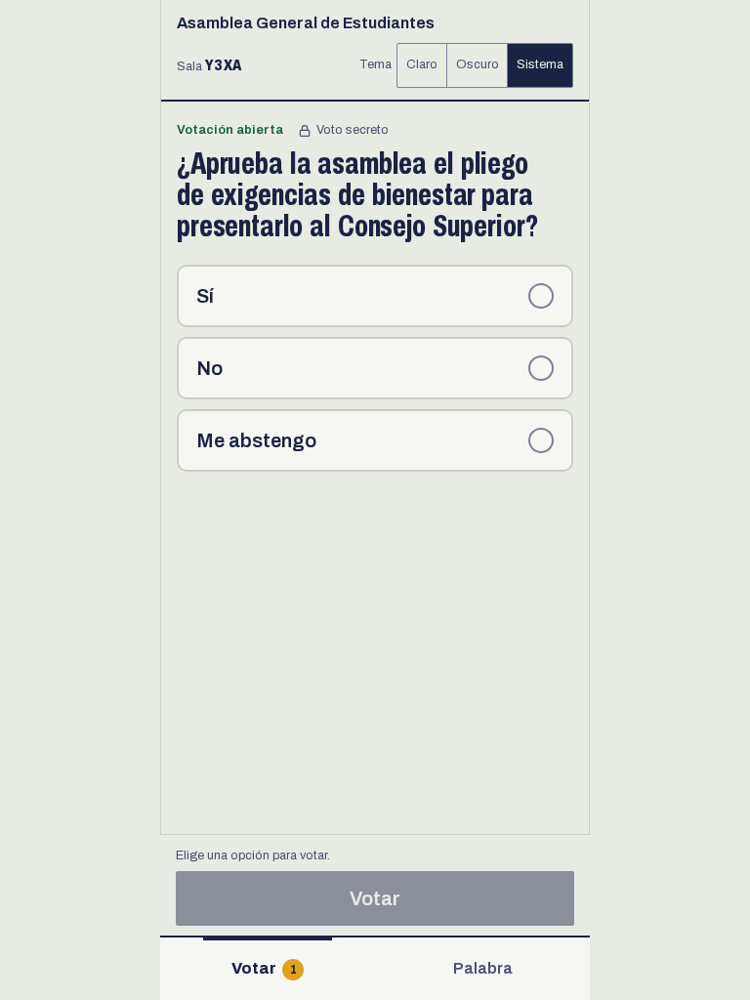

## 3. Pedir la palabra

En la pestaña **Palabra** escribe cómo quieres que te anuncien y pulsa **Pedir la palabra**. Entras al final de la fila y ves tu lugar. Con **Retirarme de la fila** sales cuando quieras.

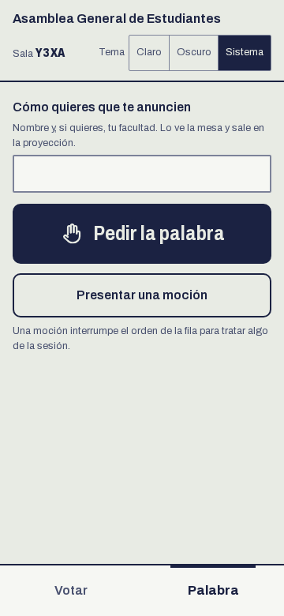

Cuando la mesa te da la palabra, la pantalla lo avisa y empieza tu cronómetro:

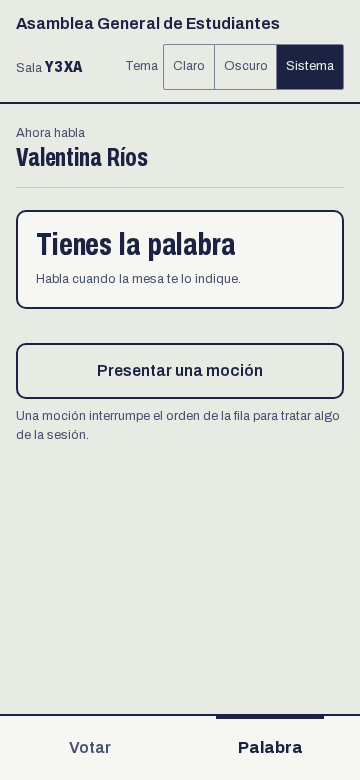

## 4. Presentar una moción

Una moción interrumpe el orden de la fila. Pulsa **Presentar una moción**, elige el tipo y envíala con **Presentar moción**.

- **De orden:** señalar que no se está cumpliendo el reglamento.
- **De procedimiento:** proponer cómo avanzar (por ejemplo, un receso).
- **De aclaración:** pedir que se explique algo.
- **De suficiente ilustración:** proponer que se cierre la discusión.

La mesa las atiende antes que las intervenciones y puede rechazar la que no proceda.

| Claro                                                                       | Oscuro                                                                        |
| --------------------------------------------------------------------------- | ----------------------------------------------------------------------------- |
| 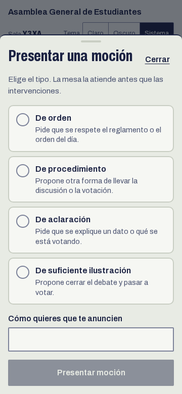 | 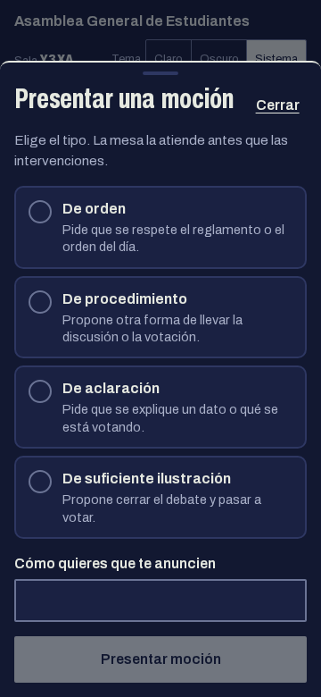 |

Tu moción queda en la fila, marcada:

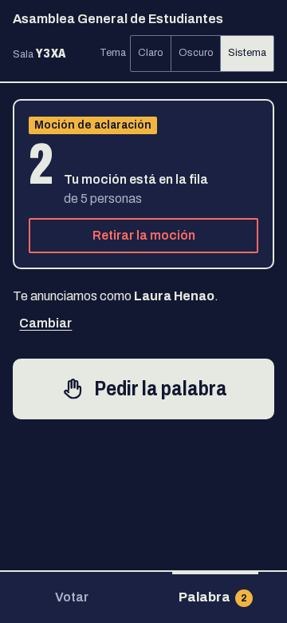

## Tema

Arriba tienes el selector de tema: claro, oscuro o el del sistema. Se guarda en tu navegador.
