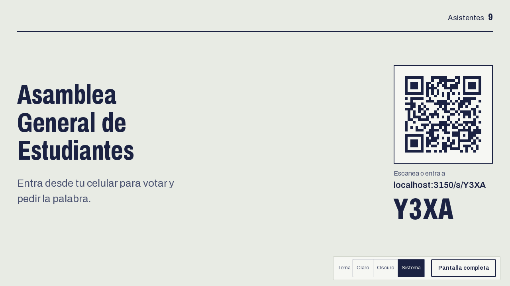
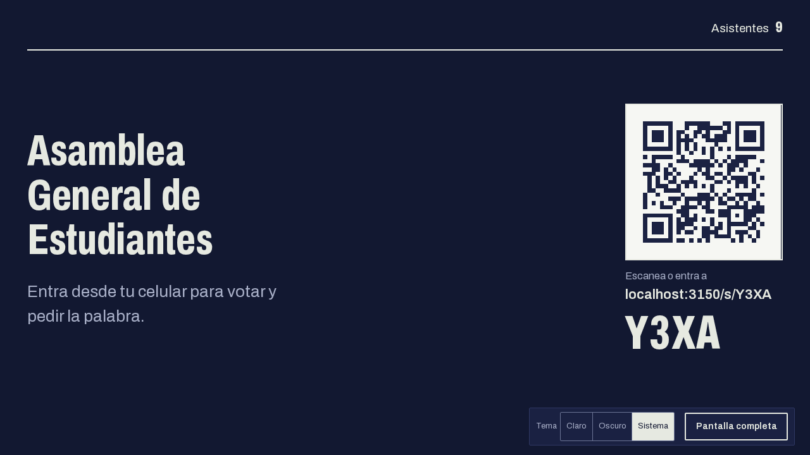
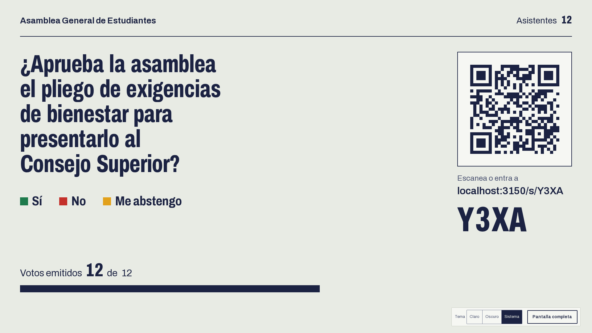
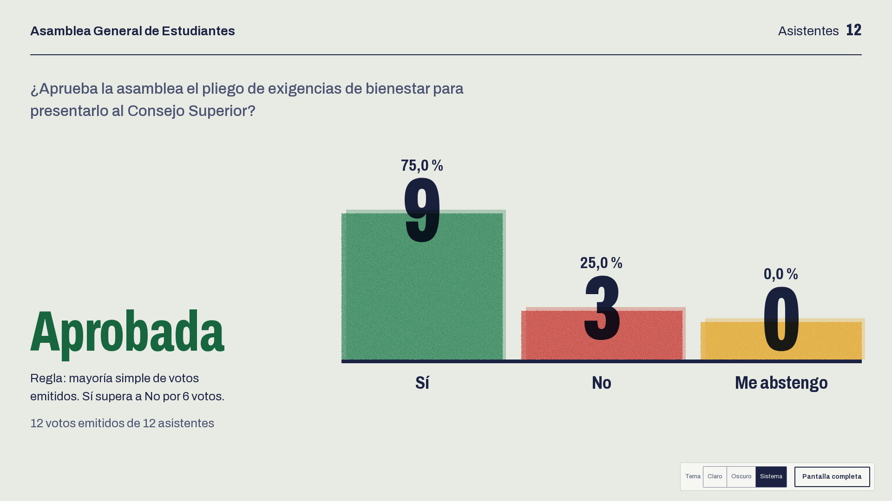
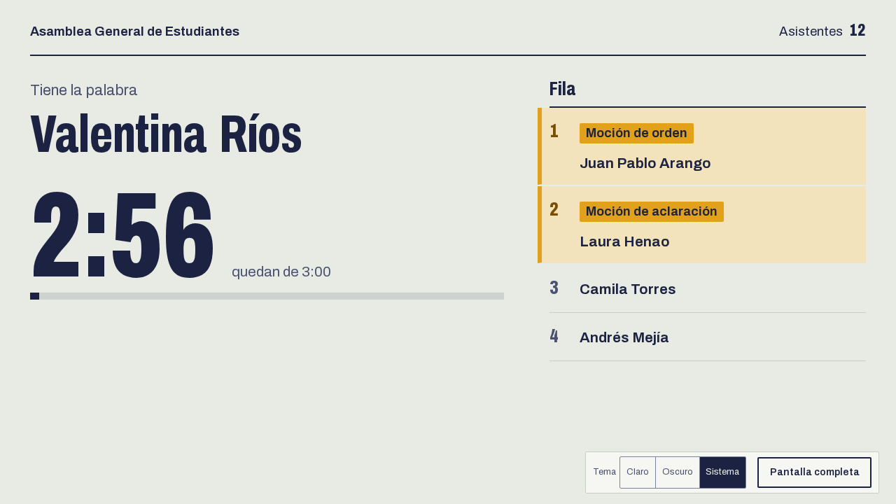
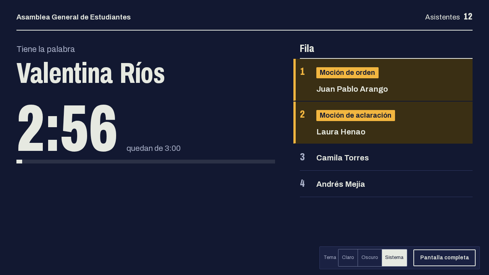

# Guía de la proyección

Es la pantalla para el videobeam o para compartir en Zoom. No tiene botones que la mesa tenga que tocar: muestra lo que pasa en la sala y se actualiza cada pocos segundos.

## Abrirla

Desde la sesión, la mesa pulsa **Abrir proyección**, o entra a `/proyeccion/<código de sala>`. No pide ingreso. Proyecta a pantalla completa con el botón **Pantalla completa** de la esquina, donde también está el selector de tema. Funciona en 1280 px y en 1920 px.

## Qué muestra

### Esperando

Antes de abrir una votación muestra el nombre de la sesión, cuántas personas han entrado y el QR con el código de sala para que entren.

| 1280 px, claro                                                    | 1280 px, oscuro                                                     |
| ----------------------------------------------------------------- | ------------------------------------------------------------------- |
|  |  |

### Votación abierta

Muestra la pregunta, las opciones con su color, el QR, y el avance: cuántos votos van y, en una sala con códigos, de cuántos asistentes. Los resultados por opción no aparecen hasta que la mesa cierre y proyecte, para que nadie vote viendo cómo van.

| 1280 px                                                        | 1920 px                                                        |
| -------------------------------------------------------------- | -------------------------------------------------------------- |
|  |  |

En una sala abierta la pantalla lleva la marca "Votación indicativa".

### Resultados

Cuando la mesa pulsa **Proyectar resultado**, la pantalla muestra el veredicto (aprobada, rechazada o empate por mayoría simple), el total de votos emitidos y el número por opción con su porcentaje.

### Palabra

Cuando la mesa da la palabra, la pantalla muestra quién habla, el tipo de moción si es una, el cronómetro y las siguientes personas de la fila.

## Consejos

- Prueba la proyección antes de que llegue la gente: abre la sala, mira el QR desde el fondo del salón y ajusta el zoom del navegador si hace falta.
- Si la conexión se cae, la pantalla avisa "Sin conexión, reintentando" y se recupera sola al volver.
- El modo oscuro rinde mejor en un salón con poca luz, el claro en uno iluminado.
